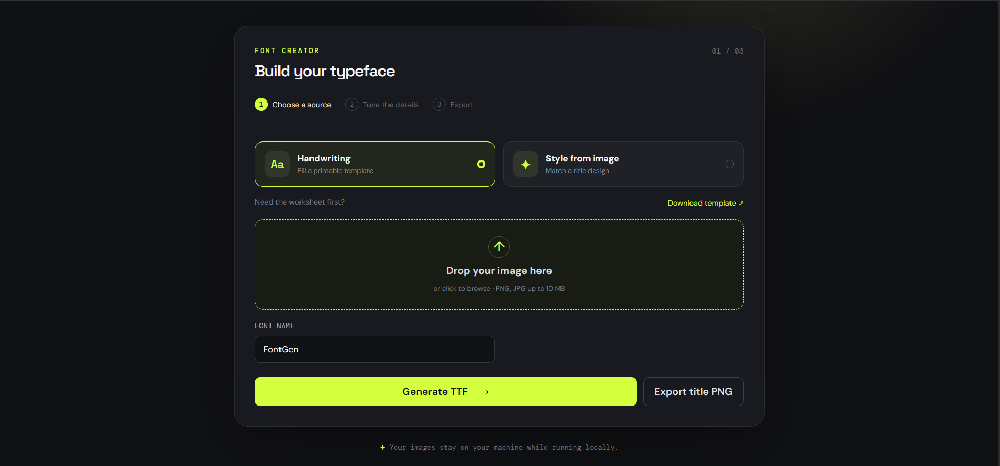

# FontGen

> **Project under construction:** FontGen is actively being developed. Some features, including font generation compatibility and AI-assisted style matching, may change or require further testing.

FontGen turns handwriting templates and title images into installable TTF files. It also exports a transparent PNG cutout for compositing 3D title artwork in CapCut.

## Preview

### Landing page


### Font creator



## Features

- Generate a font from a handwritten template.
- Match a title image style and export a TTF.
- Export title artwork as a transparent PNG.
- Run locally so uploaded images stay on your machine.

## Run locally

### Backend

```powershell
cd backend
python -m pip install -r requirements.txt
uvicorn app.main:app --reload
```

Set `GEMINI_API_KEY` to enable AI completion for the `ai` and `style` modes.

### Frontend

```powershell
cd frontend
npm install
npm run dev
```

Set `VITE_API` when the backend is not running on `http://127.0.0.1:8000`.

---

<p align="center">Developed by <strong>Bijon</strong></p>
